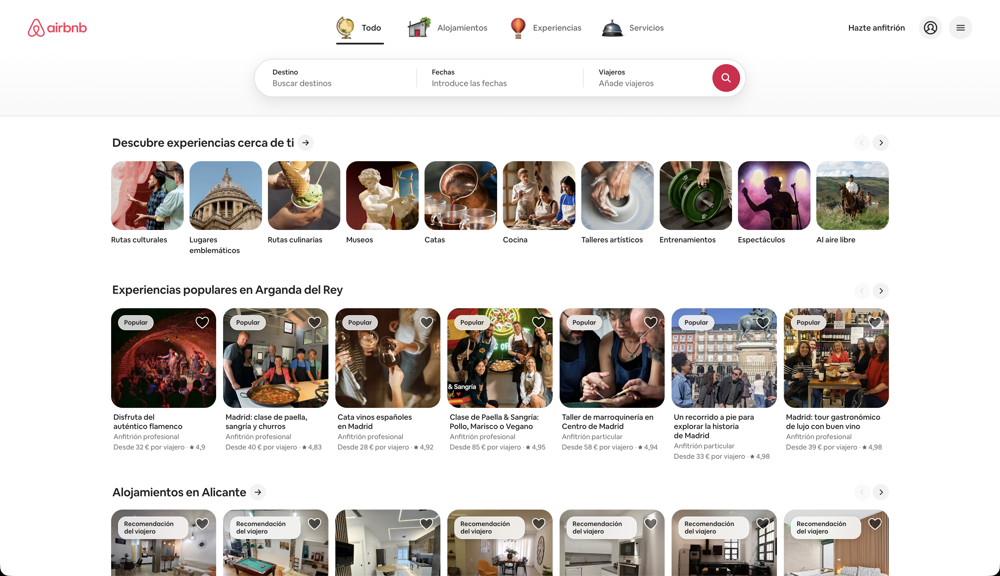
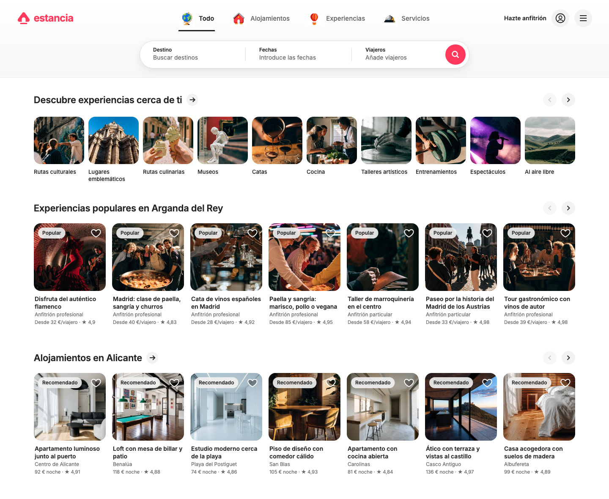
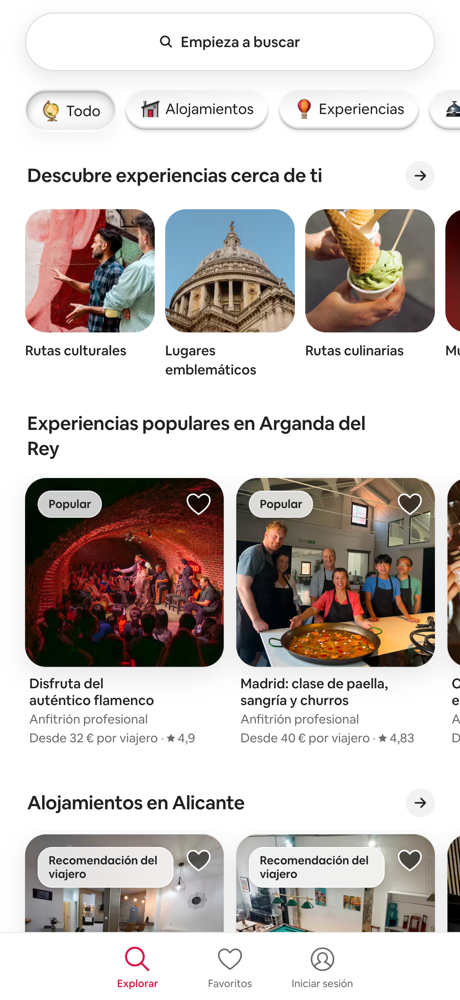
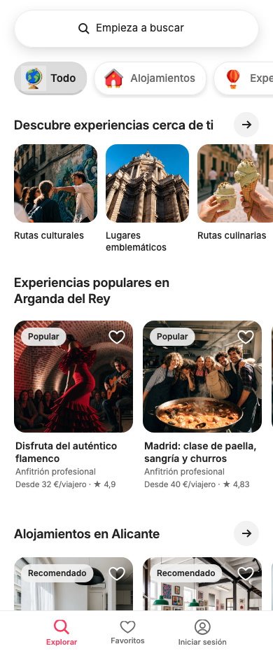

# I told Fanta to recreate Airbnb

An editable desktop and mobile travel marketplace design created with Fanta and its AI agent. The project uses the original name **estancia**, Spanish copy, reusable components, design variables, and generated travel photography.

The design lives in readable **FNX source**: canvas edits save to the project files, and valid source edits update the canvas in Fanta.

## Screens

The original Airbnb screenshots below were supplied as visual references for this design study. The Fanta recreations use the name **estancia** and generated photography.

### Desktop — Inicio

1440 × 1180 pixels, with navigation, search, experience and stay cards, and category tiles.

| Airbnb reference | Fanta recreation |
| --- | --- |
|  |  |

### Mobile — Inicio

390 × 940 pixels, with a compact search layout, cards, and a bottom tab bar.

| Airbnb reference | Fanta recreation |
| --- | --- |
|  |  |

## Open and edit

1. [Download Fanta](https://www.fantaisa.net/download) for an Apple Silicon Mac.
2. Clone this repository or download its ZIP and extract it.
3. Open the repository folder as a project in Fanta.
4. Open **Page 1** and select **Desktop — Inicio** or **Mobile — Inicio**.
5. Edit a layer on the canvas or its FNX source, then save the project.

This repository contains the design project. The screens are editable design layouts rather than a deployed booking application.

## Project files

- `fanta.json`: project manifest.
- `pages/page-1/page.fnx`: page and screen source.
- `components/experience-card/`: reusable experience and stay card.
- `components/category-tile/`: reusable category tile.
- `doc/variables.json`: theme and design variables.
- `assets/images/`: project photography and icon assets.
- `readme-assets/`: exported screen previews.
- `references/`: original desktop and mobile Airbnb reference screenshots.
- `fanta.md`: project design specification.
- `AGENTS.md`: project instructions for working with the design source.

## Try Fanta

- [Fanta website](https://www.fantaisa.net)
- [Documentation](https://fanta-docs.vercel.app)
- [Fanta Community on Discord](https://discord.gg/qrFtymBYxk)
